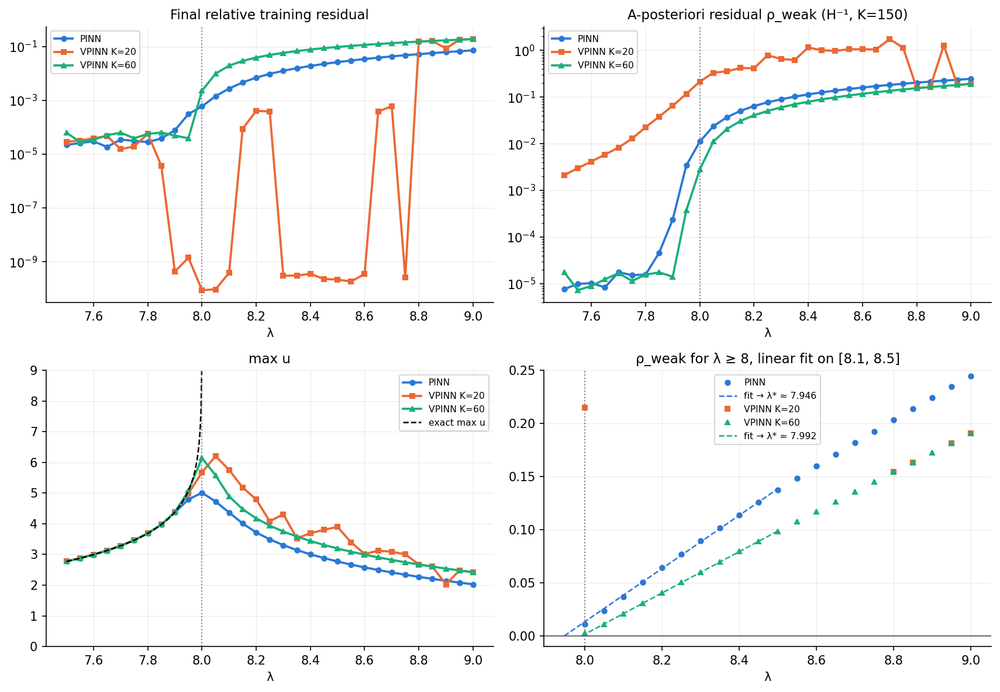
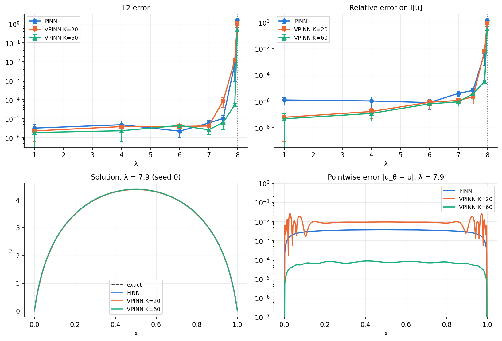
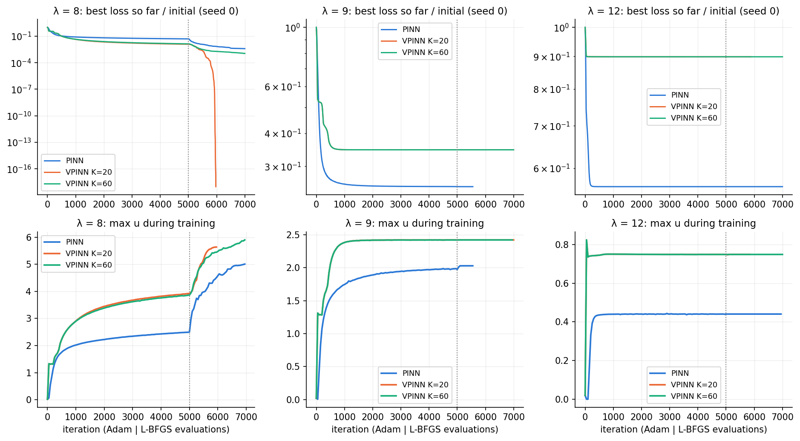
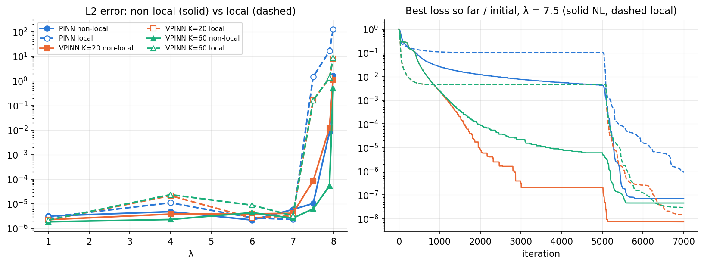
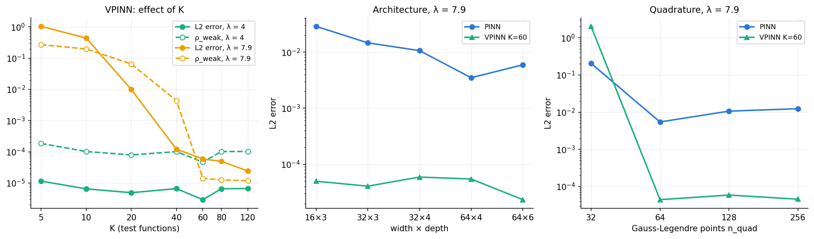
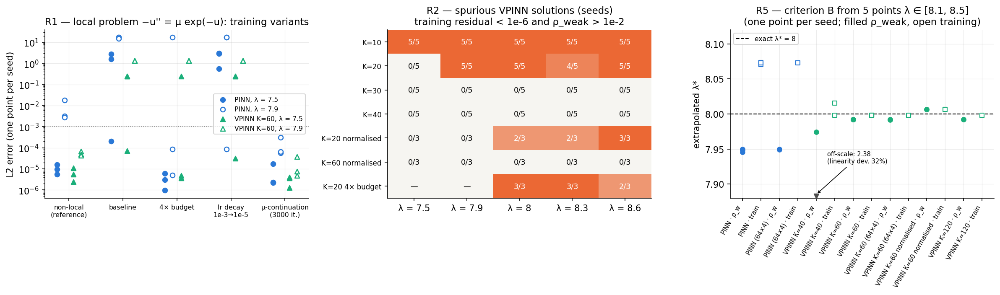
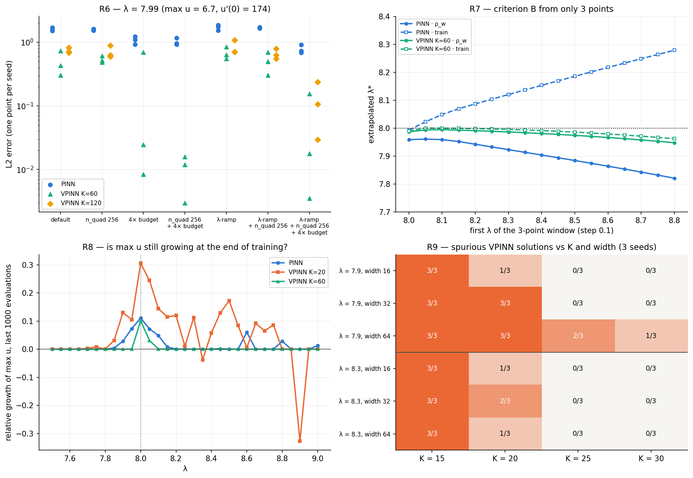

# PINN vs VPINN for the Non-Local Thermistor Problem (Ohmic Heating and Thermal Runaway)

> A benchmark of Physics-Informed Neural Networks (PINN) and Variational PINNs (VPINN) on the steady **non-local thermistor problem**: a nonlinear elliptic equation whose source term depends on an integral of the unknown, with an exact solution, a sharp existence threshold ($\lambda^\ast = 8$) and thermal runaway beyond it. To our knowledge (non-exhaustive literature search, November 2026), no PINN or VPINN study of this problem has been published.

## Key Findings

Why a 1D problem with a known solution? Because it has a ground truth **and** a sharp threshold beyond which no solution exists, so it shows what PINNs and VPINNs do when the physics says "impossible".

1. **A low training loss proves nothing.** With too few test functions (K ≤ 20), the VPINN reaches a loss of 10⁻¹⁶ on problems that have *no solution* (up to λ ≈ 8.75). This is reproducible across seeds and survives 4× longer training. An a-posteriori residual on an enriched test space detects it at the cost of one evaluation.
2. **Near the threshold, a well-resolved VPINN wins.** At λ = 7.9 it is about 100× more accurate than the PINN (65× median, 165× mean over 5 seeds). At λ = 7.99 it still reaches $L^2 = 10^{-2}$ with a larger budget and a finer quadrature; the PINN stays at $L^2 \approx 1$. Away from the threshold (λ ≤ 7) both are equivalent (~10⁻⁶).
3. **The critical value can be recovered from where no solution exists.** The VPINN residual floor grows linearly beyond λ\*. Extrapolating it from 5 values of λ in [8.1, 8.5] gives λ\* within 0.1 % of 8 for every seed and architecture tested (within 0.2 % from only 3 values).
4. **The non-local term acts as a free continuation.** The equivalent local problem fails near the threshold unless it is trained with an explicit continuation; the integral normalisation provides one automatically.

<p align="center">
  
</p>

*Left to right, top to bottom: training residual, a-posteriori residual, max u, and the linear extrapolation of the post-critical floor that recovers λ\* = 8. Details, limits and every number below.*

---

## Problem Statement

A conductor with temperature-dependent resistivity $f(u)$ is driven by a fixed potential difference. Ohmic heating then produces a **non-local** source term (Lacey, 1995):

$$-u''(x) = \frac{\lambda\, f(u)}{\left(\int_0^1 f(u)\,dx\right)^2}, \qquad x \in (0,1), \qquad u(0) = u(1) = 0, \qquad f(u) = e^{-u}$$

### Exact Solution

With $b = 2\arcsin\sqrt{\lambda/8} \in (0, \pi)$:

$$u(x) = 2 \ln \frac{\cos\bigl(b(x - \tfrac12)\bigr)}{\cos(b/2)}, \qquad I[u] = \int_0^1 e^{-u}\,dx = \frac{\sin b}{b}, \qquad \lambda = 8 \sin^2(b/2)$$

$\lambda(b)$ is strictly increasing from $(0,\pi)$ onto $(0, 8)$, so:

| Regime | Steady state |
|---|---|
| $0 < \lambda < 8$ | unique solution, $\max u = -2\ln\cos(b/2)$ |
| $\lambda \to 8^-$ | $\max u \to \infty$, boundary layers of width $\sim \pi - b$ |
| $\lambda \ge 8$ | **no solution** (thermal runaway) |

Lacey works on $(-1, 1)$. With $x = 2y - 1$, the factor $1/4$ from $u_{xx}$ and the factor $2^2$ from $(\int_{-1}^{1} f\,dx)^2$ cancel, so the threshold $\lambda^\ast = 8$ is unchanged on $(0,1)$. The solution is verified symbolically (sympy) and numerically in [`tests/test_exact_solution.py`](tests/test_exact_solution.py).

| $\lambda$ | 1 | 4 | 6 | 7 | 7.5 | 7.9 | 7.99 |
|---|---|---|---|---|---|---|---|
| $\max u$ | 0.134 | 0.693 | 1.386 | 2.079 | 2.773 | 4.382 | 6.685 |
| $u'(0)$ | 0.55 | 3.14 | 7.26 | 12.8 | 20.4 | 51.9 | 173.6 |
| $\mu = \lambda / I^2$ | 1.19 | 9.87 | 35.1 | 93.6 | 222 | 1362 | 15090 |

---

## Methods

Both methods share **everything except the loss** ([`src/utils.py`](src/utils.py)):

- **Ansatz:** $u_\theta(x) = x(1-x)\,N_\theta(2x-1)$, so the Dirichlet conditions hold exactly (hard constraints) and each loss has a single term with no penalty weight.
- **Network:** tanh MLP, Xavier initialisation, 4 hidden layers × 32 neurons, float64, same seed.
- **Optimiser and budget:** 5 000 Adam iterations (lr = 10⁻³), then at most 2 000 L-BFGS loss evaluations (strong Wolfe).
- **Non-local term:** $I[u_\theta] = \sum_q w_q e^{-u_\theta(x_q)}$ with the same $n_q = 128$ Gauss-Legendre nodes for both methods. It is recomputed at every iteration and differentiated end-to-end, so the gradient contains $\partial I / \partial\theta$.

### PINN (strong form)

$$\mathcal{L}_{\text{PINN}} = \frac{1}{n_q}\sum_q \Bigl[-u_\theta''(x_q) - \lambda\, e^{-u_\theta(x_q)} / I[u_\theta]^2\Bigr]^2$$

$u''$ is computed by automatic differentiation. The collocation points are the Gauss-Legendre nodes, so both methods use the same point set.

### VPINN (weak form)

$$R_k = \int_0^1 u_\theta' v_k'\,dx - \frac{\lambda}{I[u_\theta]^2}\int_0^1 e^{-u_\theta} v_k\,dx, \qquad \mathcal{L}_{\text{VPINN}} = \sum_{k=1}^K R_k^2$$

The test functions are $v_k = P_{k+1}(\xi) - P_{k-1}(\xi)$ with $\xi = 2x - 1$ (Legendre), so $v_k(0) = v_k(1) = 0$ and $v_k' = 2(2k+1)P_k(\xi)$. Only first derivatives of the network are needed. Two test spaces are compared: **K = 20** and **K = 60**.

### A-posteriori diagnostics (independent of the training discretisation)

These are evaluated on a fine composite Gauss rule (400 × 8 nodes):

- errors $L^2$, $L^\infty$, $H^1$ (full norm), and relative errors on $I[u]$ and $\max u$;
- **$\rho_{\text{weak}}$**: relative residual in a truncated $H^{-1}$ norm, built from $K_{\text{val}} = 150$ normalised test functions. The $v_k'/\lVert v_k'\rVert$ are $L^2$-orthonormal, so $\sum_k (R_k / \lVert v_k' \rVert)^2$ is exactly the $H^{-1}$ norm of the residual projected on the first 150 modes. It requires no exact solution and is valid for $\lambda \ge 8$.

---

## Results

All numbers come from `python src/run_all.py` (20 min on 10 CPU processes). Values are mean ± std over 3 seeds (2 for the sweep and the ablations). Full tables: [`results/results_summary.md`](results/results_summary.md).

### E1 — Accuracy vs λ

| λ | PINN L2 | VPINN K=20 L2 | VPINN K=60 L2 | PINN H1 | VPINN K=20 H1 | VPINN K=60 H1 |
|---|---|---|---|---|---|---|
| 1 | 3.2 × 10⁻⁶ | 2.3 × 10⁻⁶ | **1.9 × 10⁻⁶** | 3.9 × 10⁻⁵ | 4.4 × 10⁻⁵ | **3.7 × 10⁻⁵** |
| 4 | 4.8 × 10⁻⁶ | 3.8 × 10⁻⁶ | **2.3 × 10⁻⁶** | 7.7 × 10⁻⁵ | 9.9 × 10⁻⁵ | **6.0 × 10⁻⁵** |
| 6 | **2.2 × 10⁻⁶** | 3.9 × 10⁻⁶ | 4.4 × 10⁻⁶ | **4.5 × 10⁻⁵** | 1.3 × 10⁻⁴ | 1.5 × 10⁻⁴ |
| 7 | 5.9 × 10⁻⁶ | 4.1 × 10⁻⁶ | **2.6 × 10⁻⁶** | **4.6 × 10⁻⁵** | 2.3 × 10⁻⁴ | 9.8 × 10⁻⁵ |
| 7.5 | 1.0 × 10⁻⁵ | 8.5 × 10⁻⁵ | **6.2 × 10⁻⁶** | **7.1 × 10⁻⁵** | 1.2 × 10⁻² | 1.1 × 10⁻⁴ |
| 7.9 | 8.0 × 10⁻³ ± 7.1 × 10⁻³ | 1.2 × 10⁻² | **5.3 × 10⁻⁵** | 4.1 × 10⁻² | 1.0 | **3.4 × 10⁻⁴** |
| 7.99 | 1.6 (fail) | 1.1 (fail) | 0.49 (fail) | 11 | 8.9 | 3.8 |

Mean time per training (single thread, 10 runs in parallel): PINN ≈ 36 s, VPINN ≈ 25 s.

<p align="center">
  
</p>

- For $\lambda \le 7$ the three methods are equivalent in $L^2$ (2–6 × 10⁻⁶). The differences are of the order of the seed-to-seed spread.
- The VPINN computes $I[u]$ 20× more accurately at small λ (relative error 5 × 10⁻⁸ vs 1.3 × 10⁻⁶ at λ = 1).
- **Where the VPINN loses:** the PINN has the best $H^1$ error for $6 \le \lambda \le 7.5$. At $\lambda = 7.5$, the VPINN with K = 20 is 8× worse in $L^2$ and 170× worse in $H^1$ (oscillations near the boundary layers). At $\lambda = 7.9$, the VPINN with K = 20 is also worse than the PINN.
- Close to the threshold ($\lambda = 7.9$, $u'(0) = 52$), the VPINN with K = 60 is about **two orders of magnitude more accurate** than the PINN. Over 5 seeds (robustness check R4), the median L2 is $4.9 \times 10^{-5}$ vs $3.2 \times 10^{-3}$ (65×) and the mean is $8.6 \times 10^{-5}$ vs $1.4 \times 10^{-2}$ (165×). The PINN result also varies strongly between seeds ($2.5 \times 10^{-3}$ to $4.4 \times 10^{-2}$).
- At $\lambda = 7.99$ ($\max u = 6.7$, $u'(0) = 174$) **every method fails** with the default budget ($L^2 \ge 0.49$). Robustness check R6 shows that this is a budget-and-quadrature limit for the VPINN but not for the PINN.

### E2 — Non-existence (λ ≥ 8): can the loss floor detect it?

| λ | Method | final training loss | relative training residual | ρ_weak (a-posteriori) | max u |
|---|---|---|---|---|---|
| 8 | PINN | 2.7 × 10⁻¹ | 6.2 × 10⁻⁴ | 1.1 × 10⁻² | 4.99, still growing |
| 8 | VPINN K=20 | **9.6 × 10⁻¹⁷** | 1.2 × 10⁻¹⁰ | **2.2 × 10⁻¹** | 5.53, still growing |
| 8 | VPINN K=60 | 6.9 × 10⁻² | 2.7 × 10⁻³ | 3.1 × 10⁻³ | 6.00, still growing |
| 9 | PINN | 20.5 | 7.3 × 10⁻² | 0.25 | 2.03 |
| 9 | VPINN K=20 / K=60 | 28.1 / 28.1 | 0.19 / 0.19 | 0.19 / 0.19 | 2.42 / 2.42 |
| 12 | PINN | 81 | 0.48 | 0.74 | 0.44 |
| 12 | VPINN K=20 / K=60 | 130 / 130 | 0.66 / 0.66 | 0.65 / 0.65 | 0.75 / 0.75 |

<p align="center">
  = 8">
</p>

*At λ = 9 and 12 the K = 20 and K = 60 curves coincide: both converge to the same minimiser (seed-to-seed std ≤ 10⁻⁶).*

- **At λ = 8**, the solution blows up. Every method shows $\max u$ still increasing at the end of training, the expected signature of runaway. The loss floor alone is ambiguous: the VPINN with K = 20 reaches **10⁻¹⁶**, a *spurious solution* to a problem that has none.
- **For λ ≥ 9** all methods stop at a clear, seed-independent floor, and $\max u$ settles at a moderate value. The networks converge to a finite least-squares compromise, not to a blow-up.
- The minimal residual for λ > 8 is almost entirely a **uniform heat sink**. 89–99 % of its $H^{-1}$ energy lies in mode $k = 1$ ($v_1'' = $ const) for the PINN and the VPINN with K = 60. Because $\int_0^1 v_k\,dx = 0$ for $k \ge 2$, this also explains why K = 20 and K = 60 give the same floor at λ = 9 and 12. At λ = 8.3, in contrast, the VPINN with K = 20 hides **96 %** of its residual in modes $k > 20$, which it never tests: this is the spurious-solution mechanism.

#### Criterion A — threshold on a residual

$\lambda^\ast_{\text{seen}}(\tau)$ is the smallest grid value from which the detector stays above $\tau$ on a sweep $\lambda \in [7.5, 9.0]$ (step 0.05, median of 2 seeds).

| τ | PINN (train) | VPINN K=20 (train) | VPINN K=60 (train) | PINN (ρ_weak) | VPINN K=20 (ρ_weak) | VPINN K=60 (ρ_weak) |
|---|---|---|---|---|---|---|
| 10⁻³ | 8.05 | 8.8 | 8.0 | 7.95 | ≤ 7.5 | 8.0 |
| 10⁻² | 8.3 | 8.8 | 8.1 | 8.0 | 7.75 | 8.05 |
| 3 × 10⁻² | 8.55 | 8.8 | 8.2 | 8.1 | 7.85 | 8.15 |

- With its training loss, the **VPINN K = 20 "sees" solutions up to λ ≈ 8.75**, 10 % beyond the true threshold.
- The a-posteriori residual $\rho_{\text{weak}}$ removes this failure. It is pessimistic for K = 20, flagging λ = 7.75 where a solution exists, which is correct in the sense that the K = 20 approximation is unreliable there. For the PINN and K = 60, $\rho_{\text{weak}}$ places $\lambda^\ast$ within 0.05–0.15 of 8, depending on τ.
- The transition is smooth, not a jump: near $\lambda = 8$ the true solution itself becomes unresolvable, so a threshold criterion carries an inherent uncertainty of ~0.1 that depends on τ.

#### Criterion B — extrapolating the post-critical floor

Fit $\rho(\lambda) \approx a(\lambda - \lambda^\ast)$ on a window of λ values clearly above the threshold, and extrapolate to zero.

| Method | detector | fit [8.1, 8.5] | fit [8.2, 8.6] | fit [8.3, 8.7] | fit [8.5, 9.0] |
|---|---|---|---|---|---|
| PINN | training residual | 8.075 | 8.113 | 8.147 | 8.225 |
| PINN | ρ_weak | 7.946 | 7.927 | 7.907 | 7.857 |
| VPINN K=20 | training residual | not linear (deviation 37–65 %) | | | |
| VPINN K=60 | training residual | **7.998** | **7.996** | **7.991** | **7.976** |
| VPINN K=60 | ρ_weak | **7.992** | **7.987** | **7.981** | **7.963** |

For the VPINN with K = 60, the floor is linear in λ to better than 0.5 %. Extrapolation recovers **λ\* = 8.00 ± 0.01** from the window [8.1, 8.5], without ever solving close to the singular regime. The PINN floor is less linear, and its estimate drifts by up to 0.15 with the window. This linearity is an empirical observation; we have no proof.

<p align="center">
  
</p>

### E3 — What does the non-local term cost?

The same exact solution also solves the **local** problem $-u'' = \mu e^{-u}$ with $\mu = \lambda / I_{\text{exact}}^2$. Same networks, seeds and budget:

| λ | μ | Method | L2 non-local | L2 local | local runs that converge |
|---|---|---|---|---|---|
| 4 | 9.87 | PINN / VPINN K=60 | 4.8 × 10⁻⁶ / 2.3 × 10⁻⁶ | 1.1 × 10⁻⁵ / 2.3 × 10⁻⁵ | 3/3 |
| 7 | 93.6 | PINN / VPINN K=60 | 5.9 × 10⁻⁶ / 2.6 × 10⁻⁶ | 2.3 × 10⁻⁶ / 3.3 × 10⁻⁶ | 3/3 |
| 7.5 | 222 | PINN / VPINN K=60 | 1.0 × 10⁻⁵ / 6.2 × 10⁻⁶ | 1.5 / 0.16 | 1/3 (2 PINN runs: non-finite L-BFGS) |
| 7.9 | 1362 | PINN / VPINN K=60 | 8.0 × 10⁻³ / 5.3 × 10⁻⁵ | 16 / 1.3 | 0/3 |

<p align="center">
  
</p>

- The non-local term **costs nothing** for λ ≤ 7. The ratio L2(non-local) / L2(local) ranges from 0.10 to 2.6 over all methods and λ ≤ 7, and in 7 of 12 cases the non-local formulation is the more accurate one (up to 10× for the VPINN at λ = 4). Every local run converges for λ ≤ 7.
- For λ ≥ 7.5 the **local** problem becomes untrainable with the default schedule. All VPINN seeds at λ = 7.9 stop at the same stationary point (loss 2.95 × 10³, $\max u = 6.5$).
- **Mechanism.** At initialisation $u_\theta \approx 0$, so $I = 1$ and the non-local source equals λ (≤ 8), whereas the local source equals μ (up to 1.5 × 10⁴). As $u_\theta$ grows, $I$ shrinks and the effective coefficient $\lambda/I^2$ rises progressively: the integral acts as a built-in **continuation in μ**. Consistent with this, at λ = 7 the non-local formulation reduces the loss by 10³ in 671 VPINN iterations versus 4 442 for the local one.
- The robustness check R1 below **confirms the mechanism and qualifies the claim**. An explicit continuation of the local problem (μ ramped geometrically from λ to its target over 3 000 Adam steps, same budget) converges for 12/12 runs. At λ = 7.9 it even beats the non-local PINN ($6 \times 10^{-5}$–$3 \times 10^{-4}$ vs $3 \times 10^{-3}$–$2 \times 10^{-2}$). The local problem is therefore not intrinsically harder: the non-local formulation provides the continuation for free, and an explicit one does as well or better. A 4× budget only partly helps; a learning-rate decay does not help.

### E4 — Ablations (λ = 7.9 unless stated)

<p align="center">
  
</p>

| K (VPINN) | 5 | 10 | 20 | 40 | 60 | 80 | 120 |
|---|---|---|---|---|---|---|---|
| L2 | 1.05 | 0.44 | 9.9 × 10⁻³ | 1.2 × 10⁻⁴ | 5.9 × 10⁻⁵ | 4.9 × 10⁻⁵ | **2.4 × 10⁻⁵** |
| final training loss | 1.4 × 10⁻¹⁶ | 2.5 × 10⁻¹⁰ | 5.7 × 10⁻¹⁶ | 9.1 × 10⁻⁶ | 6.8 × 10⁻⁶ | 4.8 × 10⁻⁶ | 4.1 × 10⁻⁶ |
| ρ_weak | 0.27 | 0.20 | 6.5 × 10⁻² | 4.4 × 10⁻³ | 1.4 × 10⁻⁵ | 1.3 × 10⁻⁵ | 1.2 × 10⁻⁵ |

- **The training loss is anti-correlated with accuracy:** the smallest losses (10⁻¹⁶) come with the worst solutions (K ≤ 20). $\rho_{\text{weak}}$ follows the true error. At λ = 4, K has no effect (L2 between 3 × 10⁻⁶ and 1.2 × 10⁻⁵ for K = 5 … 120).
- **Architecture:** the PINN improves with width (2.9 × 10⁻² for 16×3, 3.5 × 10⁻³ for 64×4). The VPINN with K = 60 is insensitive (2–6 × 10⁻⁵ from 16×3 to 64×6).
- **Quadrature:** with $n_q = 32$, **both fail**. The PINN has too few collocation points (L2 = 0.20). The VPINN with K = 60 fails worse (L2 = 2.0, deterministic over seeds), since 60 test functions on 32 nodes give an aliased, spurious weak problem. With $n_q \ge 64$, the VPINN reaches 5 × 10⁻⁵ and the PINN 0.5–1.2 × 10⁻². Rule of thumb: keep $n_q \gtrsim K$.

### Robustness checks

`python src/study_robustness.py` (~25 min, ~440 trainings; full tables in [`results/robustness_summary.md`](results/robustness_summary.md)) tests whether the main claims survive more seeds, longer training and fairer settings.

<p align="center">
  
</p>

**R1 — Is the failure of the local problem only a budget issue?** (3 seeds; converged = L2 < 10⁻³)

| λ | Method | non-local (reference) | local, default | local, 4× budget | local, lr decay 10⁻³→10⁻⁵ | local, μ-continuation |
|---|---|---|---|---|---|---|
| 7.5 | PINN | 3/3 | 1/3 | 3/3 | 0/3 | **3/3** |
| 7.5 | VPINN K=60 | 3/3 | 1/3 | 2/3 | 1/3 | **3/3** |
| 7.9 | PINN | 0/3 (L2 ≈ 3 × 10⁻³) | 0/3 | 2/3 | 1/3 | **3/3** |
| 7.9 | VPINN K=60 | 3/3 | 0/3 | 0/3 | 0/3 | **3/3** |

Partly a budget issue for the PINN; for the VPINN only the continuation helps. See E3 for the interpretation.

**R2 — Are the spurious VPINN solutions an artefact?** A run is counted as spurious when its training residual is below 10⁻⁶ while its a-posteriori $\rho_{\text{weak}}$ is above 10⁻². Counts are over seeds.

| Variant | λ = 7.5 | λ = 7.9 | λ = 8 | λ = 8.3 | λ = 8.6 |
|---|---|---|---|---|---|
| K = 10 | 5/5 | 5/5 | 5/5 | 5/5 | 5/5 |
| K = 20 | 0/5 | 5/5 | 5/5 | 4/5 | 5/5 |
| K = 20, 4× budget | — | — | 3/3 | 3/3 | 2/3 |
| K = 20, normalised test functions | 0/3 | 0/3 | 2/3 | 2/3 | 3/3 |
| K = 30, 40, and 60 normalised | 0 | 0 | 0 | 0 | 0 |

The phenomenon is **structural**: it is reproducible over seeds and survives 4× longer training. It disappears for K ≥ 30 here. Normalising the test functions (loss = truncated $H^{-1}$ norm of the residual) reduces it but does not remove it at K = 20.

**R3 — Is the PINN disadvantaged by Gauss-Legendre collocation?** No, the opposite. Its default nodes cluster near the boundary layers and are the best of the options tried near the threshold.

| PINN collocation | λ = 4 | λ = 7.5 | λ = 7.9 |
|---|---|---|---|
| Gauss, 128 (default) | 4.8 × 10⁻⁶ | 1.0 × 10⁻⁵ | 8.0 × 10⁻³ |
| uniform, 128 | 1.5 × 10⁻⁶ | 1.6 × 10⁻⁴ | 2.0 × 10⁻¹ |
| random, 128 | 1.1 × 10⁻⁵ | 4.8 × 10⁻⁴ | 5.3 × 10⁻¹ |
| uniform, 512 | 1.3 × 10⁻⁶ | 1.2 × 10⁻⁵ | 1.3 × 10⁻² |
| *VPINN K = 60 (reference)* | 2.3 × 10⁻⁶ | 6.2 × 10⁻⁶ | 5.3 × 10⁻⁵ |

**R4 — 5 seeds at λ = 7.5 and 7.9.** The E1 conclusions hold (numbers quoted in E1 above).

**R5 — Is criterion B robust?** Each estimate uses only 5 sweep points λ ∈ {8.1, …, 8.5} and a single seed.

| Configuration | ρ_weak: λ* (seeds) | training residual: λ* (seeds) |
|---|---|---|
| PINN, 32×4 / 64×4 | 7.948 ± 0.002 (5) / 7.949 (2) | 8.072 ± 0.001 (5) / 8.073 (2) |
| VPINN K = 60, 32×4 / 64×4 | 7.992 ± 0.000 (5) / 7.992 (2) | 7.998 ± 0.000 (5) / 7.998 (2) |
| VPINN K = 60, normalised tests | 8.006 (2) | 8.006 (2) |
| VPINN K = 120 | 7.992 (2) | 7.998 (2) |
| VPINN K = 40 | 7.974 and **2.38** (fit rejected: linearity deviation 32 %) | 7.998, 8.015 |

- With K ≥ 60, the VPINN estimate is **within 0.1 % of λ\* = 8** for every seed, architecture and test-function normalisation.
- The PINN estimates are equally reproducible but biased: −0.65 % with ρ_weak, +0.9 % with the training residual.
- One K = 40 run picked up a partially spurious solution at λ = 8.1, which broke the fit. It is caught by a simple **acceptance test**: reject fits whose points deviate from the line by more than 5 %. All other fits deviate by at most 4.2 %.

<p align="center">
  
</p>

**R6 — Can λ = 7.99 be solved?** (3 seeds, L2 mean ± std)

| Variant | PINN | VPINN K = 60 | VPINN K = 120 |
|---|---|---|---|
| default (5 000 + 2 000) | 1.6 | 0.49 ± 0.18 | 0.74 |
| n_quad 256 | 1.6 | 0.54 | 0.70 |
| 4× budget | 1.1 | 0.24 ± 0.32 (2/3 seeds ≈ 10⁻²) | — |
| **n_quad 256 + 4× budget** | 1.0 | **1.0 × 10⁻² ± 5 × 10⁻³** (3/3 seeds) | — |
| λ-ramp 7 → 7.99 (linear in b) | 1.7 | 0.68 | 0.83 |
| λ-ramp + n_quad 256 + 4× budget | 0.77 | 5.9 × 10⁻² ± 6.8 × 10⁻² | 0.12 |

- For the VPINN, λ = 7.99 is a **budget and quadrature** limit. With 4× the iterations and 256 Gauss points, K = 60 reaches $L^2 = 10^{-2}$ (0.15 % of $\max u$) on all three seeds. The finer quadrature matters because with 128 nodes, $I[u_{\text{exact}}]$ is already wrong by 10⁻³ at this λ (see `tests/test_quadrature.py`).
- The **PINN stays at $L^2 \approx 1$** with every variant: its limit near the threshold is not the budget.
- A continuation in λ **does not help**: no gain at λ = 7.9 or 7.99 (equal, or up to 3× worse). This is consistent with E3: the non-local term already provides its own continuation. K = 120 is harder to train than K = 60 at equal budget.

**R7 — Criterion B with only 3 points.** λ\* extrapolated from 3-point windows (step 0.1), mean of 2 seeds:

| Window | [8.0, 8.2] | [8.1, 8.3] | [8.3, 8.5] | [8.6, 8.8] |
|---|---|---|---|---|
| VPINN K = 60, ρ_weak | 7.987 | 7.995 | 7.986 | 7.966 |
| VPINN K = 60, training residual | 7.990 | 8.000 | 7.995 | 7.979 |
| PINN, ρ_weak | 7.959 | 7.959 | 7.923 | 7.864 |
| PINN, training residual | 7.992 (fails linearity test) | 8.049 | 8.120 | 8.217 |

Three points within 0.3 of the threshold are enough for the VPINN with K = 60 (error ≤ 0.2 %). The bias grows slowly with distance from the threshold (−0.3 % to −0.4 % for [8.6, 8.8]). The PINN estimates drift strongly with the window.

**R8 — A dynamic signature of the critical point.** Relative growth of $\max u$ over the last 1 000 loss evaluations, median of 2 seeds, on the E2 sweep:

| λ | 7.85 | 7.90 | 7.95 | **8.00** | 8.05 | 8.10 | 8.20 |
|---|---|---|---|---|---|---|---|
| VPINN K = 60 | 1 × 10⁻⁵ | 4 × 10⁻⁵ | 3 × 10⁻⁴ | **0.10** | 3 × 10⁻² | 8 × 10⁻⁴ | 2 × 10⁻⁵ |
| PINN | 4 × 10⁻³ | 3 × 10⁻² | 7 × 10⁻² | **0.11** | 7 × 10⁻² | 5 × 10⁻² | 2 × 10⁻⁴ |

$\max u$ keeps growing at the end of training only **at λ = λ\***, the blow-up case. For λ > 8 the networks settle on a bounded least-squares compromise, so this is **not** a non-existence detector. It does locate the critical value itself, sharply for the VPINN with K = 60 (peak 300× above its level away from 8) and broadly for the PINN. The VPINN with K = 20 is too noisy to use (figure, panel c).

**R9 — Does the spurious-solution threshold depend on network size?** Spurious runs out of 3, VPINN, depth 4:

| width (parameters) | λ = 7.9: K = 15 / 20 / 25 / 30 | λ = 8.3: K = 15 / 20 / 25 / 30 |
|---|---|---|
| 16 (865) | 3 / 1 / 0 / 0 | 3 / 1 / 0 / 0 |
| 32 (3 265) | 3 / 3 / 0 / 0 | 3 / 2 / 0 / 0 |
| 64 (12 673) | 3 / 3 / **2 / 1** | 3 / 1 / 0 / 0 |

The threshold depends only **weakly** on network size. A 15× larger network shifts it from K ≈ 20–25 to K > 30 at λ = 7.9 and leaves it unchanged at λ = 8.3. Practical rule for this problem: K ≥ 40, and always check ρ_weak.

---

## Conclusions

1. **Away from the threshold (λ ≤ 7)** PINN and VPINN are equivalent in $L^2$ (~10⁻⁶). The PINN is slightly better in $H^1$ for λ ≥ 6 and the VPINN better on $I[u]$. The non-local integral, recomputed and differentiated at each iteration, adds no accuracy penalty.
2. **Near the threshold (λ = 7.9)** a VPINN with a rich enough test space (K ≥ 40) is about 2 orders of magnitude more accurate than the PINN (65× in median, 165× in mean over 5 seeds). With K = 20 it is *worse* than the PINN. At λ = 7.99 all methods fail with the default budget. With 4× the iterations and 256 quadrature points, the VPINN with K = 60 reaches $L^2 = 10^{-2}$ while the PINN stays at ~1.
3. **The VPINN training loss is not a reliable indicator.** With too few test functions (K ≤ 20 here) it reaches 10⁻¹⁶ for problems that have **no solution** (up to λ ≈ 8.75). This is structural: it is reproduced on 5/5 seeds, survives 4× longer training, and depends only weakly on network size. Near the threshold the training loss is anti-correlated with accuracy. An a-posteriori residual on an enriched test space ($H^{-1}$ norm, 150 modes) fixes this and costs one evaluation.
4. **Detecting non-existence:** a residual threshold locates λ\* only to ~0.1 (smooth transition). Linearly extrapolating the post-critical floor of a well-resolved VPINN (K ≥ 60) from 5 points in [8.1, 8.5] gives **λ\* within 0.1 % of 8** for every seed and architecture tested, with a built-in acceptance test (linearity deviation < 5 %). Three points within 0.3 of the threshold suffice (error ≤ 0.2 %). The PINN estimate is equally reproducible but biased by 0.6–0.9 %. Separately, a $\max u$ that keeps growing at the end of training marks λ\* itself (blow-up).
5. **The non-local term acts as a free continuation.** The equivalent local problem ($\mu = \lambda/I^2$) fails for λ ≥ 7.5 with a plain schedule, but converges with an explicit continuation in μ. The local problem is therefore not intrinsically harder: the self-normalising integral provides the continuation automatically.

### Limitations

- One default training budget for E1–E4. Longer training, learning-rate decay and continuation were tested only in R1, R2 and R6. Adaptive sampling and other optimisers were not tried; the PINN failure at λ = 7.99 remains open.
- 2–5 seeds per configuration. The PINN at λ = 7.9 shows a large seed-to-seed spread.
- The spurious-solution threshold was mapped for depth 4 and widths 16–64 only, with one quadrature (128 nodes).
- Times are wall-clock times of single-threaded runs executed 10 at a time; use them only for relative comparisons.
- The linearity behind criterion B is empirical, observed for one non-linearity $f(u) = e^{-u}$ in 1D.
- The optional 2D extension was not done.

---

## Repository Structure

```
.
├── README.md
├── LICENSE
├── requirements.txt
├── src/
│   ├── exact_solution.py    # closed-form solution, b(λ), I[u], μ(λ)
│   ├── network.py           # MLP + hard Dirichlet ansatz x(1-x)N(x)
│   ├── utils.py             # Gauss-Legendre, Legendre test functions, shared training loop, metrics
│   ├── pinn_solver.py       # strong-form loss
│   ├── vpinn_solver.py      # weak-form loss
│   ├── run_all.py           # E1–E4: all tables and figures
│   └── study_robustness.py  # R1–R9 robustness checks (needs run_all.py first)
├── tests/
│   ├── test_exact_solution.py   # sympy residual, λ = 8 sin²(b/2), runaway
│   └── test_quadrature.py       # Gauss rules, test functions, losses (and options) vanish on the exact solution
├── notebooks/
│   └── colab_quick_run.ipynb    # short version for Google Colab
└── results/                     # figures, CSV tables, results_summary.md
```

## Quick Start

```bash
pip install -r requirements.txt
python -m pytest tests -q              # 43 tests, ~6 s
cd src
python run_all.py                      # full benchmark, ~20 min on 10 CPU processes (results/)
python study_robustness.py             # robustness checks R1-R9, ~25 min (results/robustness_summary.md)
python run_all.py --quick              # short version, ~2 min on 10 processes (results_quick/)
python run_all.py --only E2 --nproc 4  # one experiment; raw runs are cached in results/raw/
```

Google Colab: open [`notebooks/colab_quick_run.ipynb`](notebooks/colab_quick_run.ipynb) and run all cells (~5–10 min on 2 CPU cores).

### Custom configuration

```python
from vpinn_solver import train_vpinn

res = train_vpinn(config={
    "lam": 7.9,        # non-local parameter (λ < 8 for the exact solution)
    "n_test": 60,      # Legendre test functions
    "n_quad": 128,     # Gauss-Legendre nodes (I[u] and weak integrals)
    "n_hidden": 32, "n_layers": 4,
    "n_adam": 5000, "n_lbfgs": 2000, "seed": 0,
    "problem": "nonlocal",   # or "local": -u'' = μ e^{-u}, μ = λ / I_exact²
})
print(res["metrics"]["L2"], res["metrics"]["rho_weak"])
```

---

## Key References

1. **Lacey, A.A.** (1995). Thermal runaway in a non-local problem modelling Ohmic heating. Part I: Model derivation and some special cases. *Eur. J. Appl. Math.*, 6(2), 127–144. doi:[10.1017/S095679250000173X](https://doi.org/10.1017/S095679250000173X)

2. **Lacey, A.A.** (1995). Thermal runaway in a non-local problem modelling Ohmic heating. Part II: General proof of blow-up and asymptotics of runaway. *Eur. J. Appl. Math.*, 6(3), 201–224. doi:[10.1017/S0956792500001807](https://doi.org/10.1017/S0956792500001807)

3. **Raissi, M., Perdikaris, P. & Karniadakis, G.E.** (2019). Physics-informed neural networks: A deep learning framework for solving forward and inverse problems involving nonlinear partial differential equations. *J. Comput. Phys.*, 378, 686–707.

4. **Kharazmi, E., Zhang, Z. & Karniadakis, G.E.** (2021). hp-VPINNs: Variational physics-informed neural networks with domain decomposition. *Comput. Methods Appl. Mech. Engrg.*, 374, 113547.

5. **Lagaris, I.E., Likas, A. & Fotiadis, D.I.** (1998). Artificial neural networks for solving ordinary and partial differential equations. *IEEE Trans. Neural Netw.*, 9(5), 987–1000.

The Lacey references were checked against the publisher's pages (Cambridge Core): the abstracts state the λ < 8 / λ = 8 / λ > 8 trichotomy for decreasing $f$. The closed form for $f(u) = e^{-u}$ given above was derived and verified independently in this repository.

---

## Citation

```bibtex
@software{auger2026nonlocal_thermistor_pinn,
  author       = {Auger, Maxime},
  title        = {{PINN vs VPINN for the Non-Local Thermistor Problem
                   (Ohmic Heating and Thermal Runaway)}},
  year         = {2026},
  url          = {https://github.com/MaximeAuger/nonlocal-thermistor-pinn},
  institution  = {FEMTO-ST Institute, Dept. of Applied Mechanics, SUPMICROTECH}
}
```

## License

This project is licensed under the **MIT License** — see [LICENSE](LICENSE) for details.

---

**Author:** Maxime Auger — [FEMTO-ST Institute](https://www.femto-st.fr/), Dept. of Applied Mechanics, ENSMM, Besancon, France.
